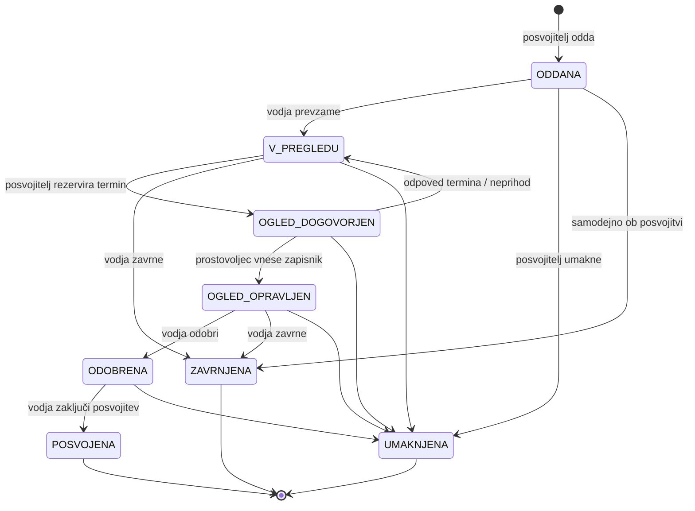

# 02 – Funkcionalnosti in obseg

## Uporabniške vloge

### Obiskovalec (neprijavljen)

**Lahko:**
- brska po javnem katalogu živali in uporablja filtre,
- si ogleda profil posamezne živali,
- se registrira kot posvojitelj.

**Ne more:**
- oddati vloge ali rezervirati ogleda,
- videti nobenih podatkov o vlogah ali drugih uporabnikih.

### Posvojitelj

**Lahko:**
- izpolni in posodablja vprašalnik o gospodinjstvu na svojem profilu,
- odda vlogo za posvojitev živali s statusom *na voljo*,
- vidi oceno ujemanja in opozorila za svojo vlogo,
- rezervira, prestavi ali odpove termin ogleda za svojo vlogo (do 24 ur pred terminom),
- spremlja stanje in zgodovino svojih vlog,
- umakne svojo vlogo, dokler ta ni zaključena.

**Ne more:**
- videti vlog drugih posvojiteljev ali tega, koliko vlog ima posamezna žival,
- videti zapisnika ogleda in internega priporočila prostovoljca,
- spreminjati stanja vloge (razen umika),
- urejati podatkov o živalih.

### Prostovoljec

**Lahko:**
- vidi seznam svojih terminov ogleda in pripadajoče vloge (vprašalnik, ocena ujemanja, opomba kandidata),
- označi ogled kot opravljen ali kot neprihod kandidata,
- vnese zapisnik ogleda in priporočilo (priporočam / s pridržki / ne priporočam),
- vidi interne opombe o vedenju živali.

**Ne more:**
- odobriti, zavrniti ali zaključiti vloge,
- dodajati, urejati ali brisati živali,
- videti vlog, ki niso vezane na njegove termine,
- upravljati uporabnikov ali urnika terminov.

### Vodja zavetišča

**Lahko:**
- dodaja in ureja kartoteke živali ter spreminja njihov status,
- upravlja urnik prostih terminov ogleda in jih dodeljuje prostovoljcem,
- vidi vse vloge, zapisnike in zgodovino sprememb,
- prevzame vlogo v pregled, jo odobri ali zavrne s komentarjem,
- zaključi posvojitev in evidentira morebitno vrnitev živali,
- registrira prostovoljce in jim dodeli vlogo.

**Ne more:**
- spreminjati vprašalnika posvojitelja ali besedila njegove vloge,
- brisati zgodovine sprememb stanj (revizijska sled je samo za branje),
- odobriti druge vloge za žival, ki že ima odobreno vlogo, dokler ta ni umaknjena ali zavrnjena.

## Predvidene funkcionalnosti

### F1 – Kartoteka živali s statusi – **MVP**

Vodja vnese žival z vedenjskimi lastnostmi: primernost za otroke, pse in mačke, potreba po vrtu in raven energije. Žival ima status *sprejeta → na voljo → rezervirana → posvojena*. Prehodi statusa so omejeni, npr. v *posvojena* žival preide samo prek zaključka posvojitve.

### F2 – Vloga z vprašalnikom o gospodinjstvu in preverjanjem pravil – **MVP**

Posvojitelj odda vlogo za izbrano žival. Sistem pred oddajo preveri:
- da je žival *na voljo*,
- da posvojitelj nima že aktivne vloge za isto žival,
- da posvojitelj nima več kot 3 aktivnih vlog.

Vprašalnik o gospodinjstvu se shrani na profil in se ponovno uporabi pri naslednjih vlogah.

### F3 – Samodejna ocena ujemanja – **MVP**

Sistem primerja gospodinjstvo posvojitelja z lastnostmi živali, na primer:
- otroci, mlajši od 6 let, in žival, neprimerna za otroke,
- stanovanje brez vrta in žival, ki potrebuje vrt,
- žival je dnevno sama več kot 6 ur in ima visoko raven energije.

Rezultat je *ujemanje*, *pogojno* ali *neujemanje* s seznamom opozoril. Opozorila ne preprečijo oddaje vloge.

### F4 – Obravnava vloge po stanjih – **MVP**

Vloga prehaja skozi stanja *oddana → v pregledu → ogled dogovorjen → ogled opravljen → odobrena / zavrnjena → posvojena*, posvojitelj jo lahko tudi *umakne*. Kateri prehodi so dovoljeni, je odvisno od vloge uporabnika. Vsaka sprememba stanja se zabeleži.

### F5 – Rezervacija ogleda iz prostih terminov – **MVP**

Posvojitelj izbere prosti termin, ki ga je vodja dodelil prostovoljcu. En termin pomeni en ogled, dvojna rezervacija ni mogoča. Termin je mogoče prestaviti ali odpovedati do 24 ur pred začetkom.

### F6 – Zapisnik ogleda s priporočilom – **MVP**

Prostovoljec po ogledu vnese zapisnik in priporočilo (*priporočam / s pridržki / ne priporočam*) ali označi, da kandidat ni prišel. Vodja lahko vlogo odobri šele, ko je zapisnik vnesen.

### F7 – Zaključek posvojitve s samodejnim zapiranjem vlog – **MVP**

Ob predaji živali vodja zaključi posvojitev. V eni transakciji:
- vloga preide v *posvojena*,
- žival preide v *posvojena*,
- vse ostale aktivne vloge za to žival se samodejno *zavrnejo* z razlogom,
- vsi kandidati prejmejo obvestilo.

### F8 – Javni katalog z iskanjem in filtri

Obiskovalci in posvojitelji iščejo živali po vrsti, starosti, velikosti ter primernosti za otroke in druge živali. Prikazane so samo živali s statusom *na voljo*.

### F9 – Upravljanje urnika terminov

Vodja ustvari ponavljajoče termine ogledov (npr. vsako soboto 10:00–12:00 na 30 minut), jih dodeli prostovoljcem in označi dneve, ko je zavetišče zaprto.

### F10 – E-poštna obvestila

Sistem pošlje obvestilo ob vsaki spremembi stanja vloge, opomnik posvojitelju dan pred ogledom in opomnik vodji za vloge, ki so brez odziva več kot 5 dni.

### F11 – Nadzorna plošča vodje

Vodja vidi čakajoče vloge, vloge brez odziva, živali, ki so najdlje v zavetišču, število posvojitev po mesecih in delež vlog z neujemanjem.

### F12 – Shranjena iskanja in obvestilo o novih živalih

Posvojitelj shrani filter iskanja. Ko se pojavi nova žival, ki ustreza filtru in nima neujemanja z njegovim gospodinjstvom, prejme obvestilo.

### F13 – Evidenca vrnitve živali

Vodja zabeleži vrnitev posvojene živali z razlogom. Žival se vrne v status *na voljo*, razlog vrnitve se doda k njenim vedenjskim opombam.

### F14 – Upravljanje prostovoljcev

Vodja registrira prostovoljca, mu dodeli ali odvzame vlogo in deaktivira račun. Ob deaktivaciji se prihodnji termini prostovoljca sprostijo.

### F15 – Koledar terminov ogleda s samodejnim usklajevanjem

Nadgradi rezervacijo (F5) in urnik (F9) v koledar, ki sam skrbi za usklajenost terminov, ogledov in stanj vlog. Vključuje:
- **generiranje ponavljajočih se terminov** po pravilu (npr. vsako soboto 10:00–12:00 na 30 minut, naslednjih 8 tednov), pri čemer se izločijo dnevi, ko je zavetišče zaprto, in prekrivanja terminov istega prostovoljca,
- **koledarski prikaz** (tedenski in mesečni) prostih in zasedenih terminov za posvojitelja ter razporeda ogledov za prostovoljca in vodjo,
- **rezervacijo, varno ob sočasnih zahtevah**: če dva posvojitelja hkrati izbereta isti termin, ga dobi le eden, drugi prejme sporočilo, da termin ni več prost,
- **povezavo s stanjem vloge**: rezervacija je mogoča le za vlogo v stanju *v pregledu*; ob rezervaciji vloga preide v *ogled dogovorjen*, ob odpovedi ali neprihodu nazaj v *v pregledu*,
- **kaskadne spremembe**: ko vodja prekliče dan ali deaktivira prostovoljca, se vsi prizadeti ogledi odpovejo, vloge se vrnejo v *v pregledu* in kandidati prejmejo obvestilo s prošnjo za izbiro novega termina,
- **pravilno obravnavo časa**: termini so shranjeni v UTC in prikazani v lokalnem času (Europe/Ljubljana), tako da termin ob 10:00 ostane ob 10:00 tudi po prehodu na poletni ali zimski čas.

To je **zahtevnejša funkcionalnost** projekta, ker združuje generiranje podatkov po pravilu, sočasnost, prehode stanj vloge in kaskadne posodobitve več entitet.

Osnovna prijava, registracija in odjava so tehnična podlaga in niso posebej naštete.

**Domensko specifične MVP funkcionalnosti:** F2, F3, F4, F5, F6, F7. F1 je delno CRUD, vendar z omejenimi prehodi statusov, ki jih uporabljajo ostali procesi.

## Ključni delovni proces (stanja vloge)

Pravila:
- Ob prehodu v **ODOBRENA** žival preide v *rezervirana*; za žival je lahko odobrena največ ena vloga.
- Če je odobrena vloga umaknjena, se žival vrne v *na voljo*, ostale aktivne vloge pa nadaljujejo obravnavo.
- Ob prehodu v **POSVOJENA** se vse ostale aktivne vloge za isto žival (iz kateregakoli aktivnega stanja) samodejno zavrnejo.
- Aktivna stanja so: ODDANA, V_PREGLEDU, OGLED_DOGOVORJEN, OGLED_OPRAVLJEN, ODOBRENA.

## Kasnejše nadgradnje

1. **Spremljanje po posvojitvi** – samodejno načrtovani kontrolni klici ali obiski po 1 in 3 mesecih z zapisnikom.
2. **Posvojitvena pogodba v PDF** z vnaprej izpolnjenimi podatki in elektronskim podpisom ob predaji.
3. **Več zavetišč na eni platformi** – vsako zavetišče s svojimi živalmi, uporabniki in urnikom; skupni javni katalog.
4. **Nastavljiva pravila ujemanja** – vodja sam določi pravila in njihovo težo namesto fiksnih pravil v kodi.
5. **Urnik izmen prostovoljcev** – poleg ogledov tudi sprehodi, hranjenje in čiščenje, z razpoložljivostjo prostovoljcev.
6. **Plačilo posvojitvenega prispevka** prek spletnega plačila (npr. Stripe) ob zaključku posvojitve.
7. **Javni API** za objavo živali na drugih portalih in družbenih omrežjih.
8. **Progresivna spletna aplikacija (PWA)** za prostovoljce, z vnosom zapisnika na telefonu.

## Izven obsega (out of scope)

- Rešitev **ni veterinarska kartoteka**: ne vodi zdravljenj, zdravil, izvidov ali cepilnih shem, temveč le osnovne oznake (čipirana, cepljena, kastrirana).
- **Ni povezave** z uradnim registrom psov, bazo mikročipov ali drugimi državnimi evidencami.
- Ne obravnava **donacij, plačil ali financ** zavetišča.
- Ne omogoča **oglasov zasebnikov** za prodajo ali oddajo živali; objavlja lahko le zavetišče.
- **Ni klepeta v realnem času** med posvojiteljem in zavetiščem; komunikacija poteka prek komentarjev pri vlogi in e-pošte.
- **Ni izvorne mobilne aplikacije** (iOS/Android); rešitev je odzivna spletna aplikacija.
- Ne vodi **evidence sprejema najdenih živali** (iskanje lastnikov izgubljenih živali, zakonski roki hrambe).
