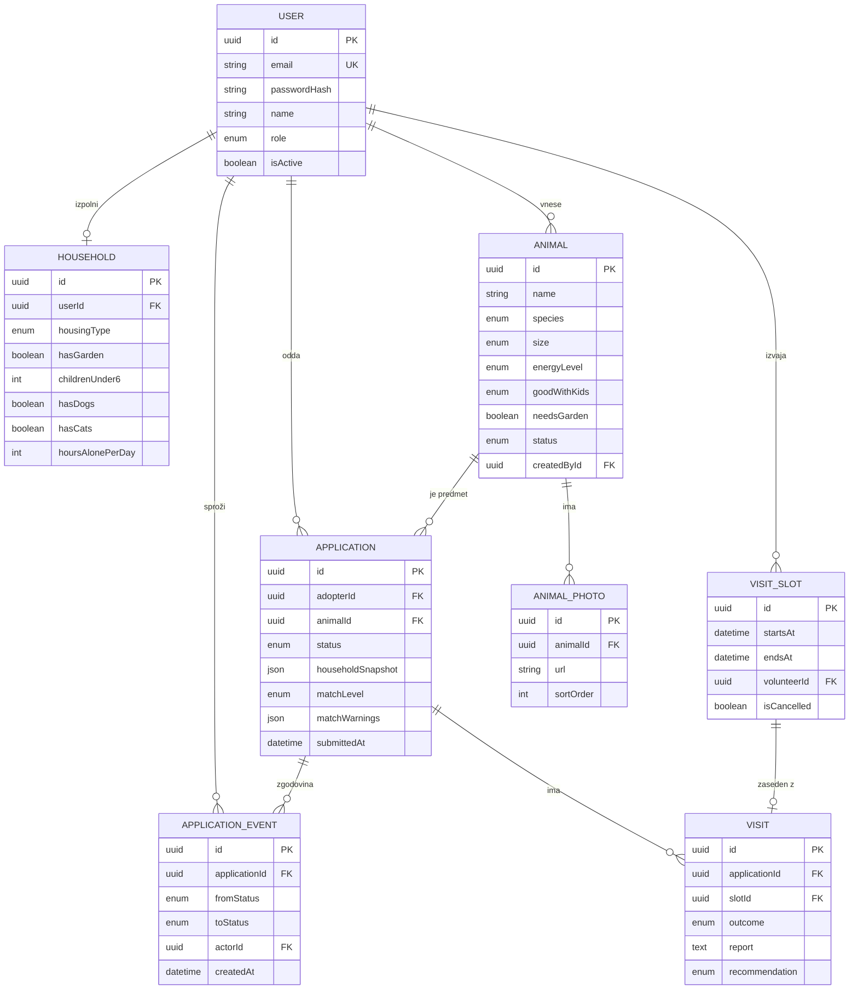

# 03 – Podatkovni model

Rešitev uporablja relacijsko podatkovno bazo **PostgreSQL**, shema je opisana in upravljana s **Prisma** (migracije). Imena tabel in polj v kodi bodo v angleščini, v tem dokumentu je ob vsakem navedeno slovensko poimenovanje.

## Entitete

### User (Uporabnik)

| Polje | Tip | Opis |
|---|---|---|
| id | UUID, PK | |
| email | string, unikaten | prijavno ime |
| passwordHash | string | zgoščeno geslo (argon2) |
| name | string | ime in priimek |
| phone | string, nullable | telefon za dogovor o ogledu |
| role | enum `ADOPTER`, `VOLUNTEER`, `MANAGER` | uporabniška vloga |
| isActive | boolean | deaktiviran uporabnik se ne more prijaviti |
| createdAt | datetime | |

### Household (Gospodinjstvo / vprašalnik)

Razmerje 1 : 1 z uporabnikom z vlogo `ADOPTER`.

| Polje | Tip | Opis |
|---|---|---|
| id | UUID, PK | |
| userId | UUID, FK → User, unikaten | |
| housingType | enum `APARTMENT`, `HOUSE` | tip bivanja |
| hasGarden | boolean | |
| childrenUnder6 | int | število otrok, mlajših od 6 let |
| childrenOver6 | int | |
| hasDogs, hasCats | boolean | druge živali v gospodinjstvu |
| hoursAlonePerDay | int | koliko ur je žival dnevno sama |
| experience | text | izkušnje z živalmi |
| updatedAt | datetime | |

### Animal (Žival)

| Polje | Tip | Opis |
|---|---|---|
| id | UUID, PK | |
| name | string | |
| species | enum `DOG`, `CAT` | |
| sex | enum `MALE`, `FEMALE` | |
| birthDateApprox | date | ocenjen datum rojstva |
| size | enum `SMALL`, `MEDIUM`, `LARGE` | |
| energyLevel | enum `LOW`, `MEDIUM`, `HIGH` | |
| goodWithKids | enum `YES`, `OVER_6`, `NO`, `UNKNOWN` | |
| goodWithDogs, goodWithCats | enum `YES`, `NO`, `UNKNOWN` | |
| needsGarden | boolean | |
| isChipped, isVaccinated, isNeutered | boolean | osnovne oznake (ni veterinarska kartoteka) |
| description | text | javni opis |
| internalNotes | text | vedenjske opombe, vidni samo osebju |
| status | enum `INTAKE`, `AVAILABLE`, `RESERVED`, `ADOPTED` | |
| intakeDate | date | datum sprejema v zavetišče |
| createdById | UUID, FK → User | vodja, ki je vnesel žival |

### AnimalPhoto (Fotografija živali)

| Polje | Tip | Opis |
|---|---|---|
| id | UUID, PK | |
| animalId | UUID, FK → Animal | |
| url | string | pot do datoteke |
| sortOrder | int | prva je naslovna |

### Application (Vloga za posvojitev)

| Polje | Tip | Opis |
|---|---|---|
| id | UUID, PK | |
| adopterId | UUID, FK → User | |
| animalId | UUID, FK → Animal | |
| status | enum `SUBMITTED`, `IN_REVIEW`, `VISIT_SCHEDULED`, `VISIT_DONE`, `APPROVED`, `REJECTED`, `WITHDRAWN`, `ADOPTED` | |
| motivation | text | besedilo posvojitelja |
| householdSnapshot | JSON | kopija vprašalnika ob oddaji (kasnejše spremembe profila ne spremenijo vloge) |
| matchLevel | enum `MATCH`, `CONDITIONAL`, `MISMATCH` | rezultat ocene ujemanja |
| matchWarnings | JSON (seznam nizov) | opozorila ocene ujemanja |
| decisionComment | text, nullable | utemeljitev odobritve/zavrnitve |
| submittedAt | datetime | |
| closedAt | datetime, nullable | čas prehoda v končno stanje |

### VisitSlot (Termin ogleda)

| Polje | Tip | Opis |
|---|---|---|
| id | UUID, PK | |
| startsAt | datetime | |
| endsAt | datetime | |
| volunteerId | UUID, FK → User | prostovoljec, ki izvede ogled |
| isCancelled | boolean | npr. zaprto zavetišče |

### Visit (Ogled)

| Polje | Tip | Opis |
|---|---|---|
| id | UUID, PK | |
| applicationId | UUID, FK → Application | |
| slotId | UUID, FK → VisitSlot | |
| outcome | enum `PENDING`, `DONE`, `NO_SHOW`, `CANCELLED` | |
| report | text, nullable | zapisnik prostovoljca |
| recommendation | enum `RECOMMEND`, `WITH_RESERVATIONS`, `NOT_RECOMMEND`, nullable | |
| reportedAt | datetime, nullable | |

### ApplicationEvent (Sprememba stanja vloge)

Revizijska sled, samo vstavljanje (brez urejanja in brisanja).

| Polje | Tip | Opis |
|---|---|---|
| id | UUID, PK | |
| applicationId | UUID, FK → Application | |
| fromStatus | enum, nullable | null ob oddaji |
| toStatus | enum | |
| actorId | UUID, FK → User, nullable | null, če je spremembo izvedel sistem (samodejna zavrnitev) |
| comment | text, nullable | |
| createdAt | datetime | |

## Povezave

| Povezava | Kardinalnost | Opis |
|---|---|---|
| User – Household | 1 : 0..1 | posvojitelj ima en vprašalnik |
| User (posvojitelj) – Application | 1 : N | posvojitelj odda več vlog |
| Animal – Application | 1 : N | za žival je lahko več vlog |
| Animal – AnimalPhoto | 1 : N | |
| User (vodja) – Animal | 1 : N | kdo je vnesel žival |
| User (prostovoljec) – VisitSlot | 1 : N | prostovoljec ima več terminov |
| Application – Visit | 1 : N | vloga ima lahko več ogledov (npr. po neprihodu), aktiven je največ eden |
| VisitSlot – Visit | 1 : 0..1 | termin je lahko zaseden z največ enim aktivnim ogledom |
| Application – ApplicationEvent | 1 : N | zgodovina stanj |
| User – ApplicationEvent | 1 : N | kdo je izvedel spremembo |

## Diagram

## Omejitve in pravila na ravni baze

Pravila iz poslovne logike so, kjer je mogoče, uveljavljena tudi v bazi, da ostanejo pravilna tudi ob sočasnih zahtevah:

- **Ena aktivna vloga na posvojitelja in žival:** delni unikatni indeks na `Application(adopterId, animalId)` `WHERE status IN ('SUBMITTED','IN_REVIEW','VISIT_SCHEDULED','VISIT_DONE','APPROVED')`.
- **Največ ena odobrena vloga na žival:** delni unikatni indeks na `Application(animalId) WHERE status = 'APPROVED'`.
- **Termin ni dvakrat rezerviran:** delni unikatni indeks na `Visit(slotId) WHERE outcome <> 'CANCELLED'`.
- Delni indeksi se dodajo z ročno SQL migracijo, ker jih Prisma shema ne izrazi neposredno.
- Pravilo »največ 3 aktivne vloge na posvojitelja« se preverja v servisnem sloju znotraj transakcije.
- Zaključek posvojitve (sprememba vloge, živali, samodejne zavrnitve ostalih vlog in zapis dogodkov) poteka v **eni transakciji**.
- Ocena ujemanja se izračuna ob oddaji in shrani (`matchLevel`, `matchWarnings`) skupaj s kopijo vprašalnika, da je odločitev kasneje sledljiva.
