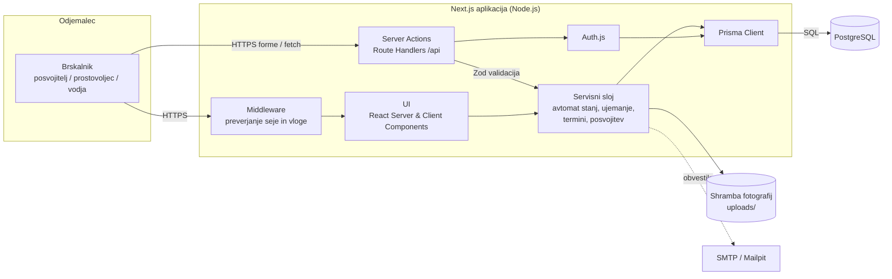

# 04 – Arhitektura in tehnološki sklad

## Arhitektura

Rešitev je **modularni monolit** v enem Next.js projektu (TypeScript), ki vsebuje uporabniški vmesnik in strežniški del. Strežniški del je razdeljen na jasno ločene sloje, tako da je domenska logika neodvisna od spletnega ogrodja.

### Glavni deli sistema

| Del | Odgovornost |
|---|---|
| **Uporabniški vmesnik** (React, Next.js App Router) | Strani za posamezne vloge: javni katalog, profil in vloge posvojitelja, seznam ogledov prostovoljca, upravljanje živali in vlog za vodjo. Strežniške komponente za prikaz podatkov, odjemalske komponente za obrazce in interakcijo. |
| **Vstopni sloj** (Server Actions in Route Handlers `/api/...`) | Sprejem zahtev, validacija vhodnih podatkov (Zod), preverjanje seje. Ne vsebuje poslovne logike, le kliče storitve. |
| **Servisni (domenski) sloj** (paket `backend/`) | Poslovna pravila: prehodi stanj vloge (avtomat stanj), ocena ujemanja, rezervacija terminov, zaključek posvojitve, preverjanje pravic (vloga + lastništvo). |
| **Podatkovni sloj** (Prisma Client) | Dostop do baze, transakcije. |
| **Podatkovna baza** (PostgreSQL) | Trajno shranjevanje, unikatne in tuje omejitve. |
| **Shramba datotek** | Fotografije živali; lokalno v mapi `uploads/`, kasneje S3-združljiva shramba. |
| **Pošiljanje e-pošte** (nadgradnja F10) | Nodemailer; lokalno se pošta lovi v Mailpit. |

### Komunikacija med deli

- Brskalnik komunicira z Next.js strežnikom prek **HTTPS**: strani se upodabljajo na strežniku (SSR), spremembe podatkov gredo prek **Server Actions** (obrazci) ali **REST Route Handlers** pod `/api` (npr. prosti termini, ki se naložijo dinamično).
- Vstopni sloj kliče **servisne funkcije** neposredno (klic funkcije v istem procesu, brez omrežja).
- Servisni sloj z bazo komunicira prek **Prisma Client** (TCP povezava na PostgreSQL). Operacije, ki spremenijo več zapisov, se izvedejo v `prisma.$transaction`.
- Route Handlers pod `/api` so zasnovani tako, da jih lahko kasneje uporablja tudi drug odjemalec (npr. PWA za prostovoljce ali javni API).

### Diagram



### Podatkovna baza

PostgreSQL 16. Shema in migracije so v `prisma/schema.prisma` in `prisma/migrations`. Testni podatki (vodja, dva prostovoljca, nekaj posvojiteljev, 10 živali, termini za naslednja dva tedna) se naložijo s skripto `prisma/seed.ts`. Podrobnosti so v `03-podatkovni-model.md`.

### Avtentikacija in upravljanje uporabnikov

- **Auth.js (NextAuth v5)** s ponudnikom **Credentials** (e-pošta in geslo).
- Gesla so zgoščena z **argon2**.
- Seja je **JWT v piškotku** `httpOnly`, `secure`, `sameSite=lax`; v žetonu sta `userId` in `role`.
- Registracija je javna samo za vlogo **posvojitelj**. Prostovoljce ustvari vodja. Prvi vodja se ustvari s seed skripto.
- **Avtorizacija** na dveh ravneh:
  1. *Middleware* preprečuje dostop do celih področij (`/upravljanje/*` samo vodja, `/ogledi/*` prostovoljec in vodja, `/moje-vloge/*` prijavljen posvojitelj).
  2. *Servisni sloj* pri vsaki operaciji preveri vlogo **in lastništvo** (npr. posvojitelj lahko umakne le svojo vlogo, prostovoljec vnese zapisnik le za ogled v svojem terminu). Pri kritičnih operacijah se vloga in `isActive` ponovno prebere iz baze, da deaktivacija učinkuje takoj.

### Lokalni zagon

Predpogoji: Node.js 22 LTS, pnpm, Docker.

```bash
git clone <repo> novi-dom && cd novi-dom
cp .env.example .env          # DATABASE_URL, AUTH_SECRET, SMTP_*
docker compose up -d          # PostgreSQL 16 (port 5432) in Mailpit (UI na 8025)
pnpm install                  # namesti odvisnosti za frontend/ in backend/ (pnpm workspace)
pnpm db:migrate               # prisma migrate dev v backend/
pnpm db:seed                  # testni uporabniki in živali
pnpm dev                      # aplikacija na http://localhost:3000
```

Testi: `pnpm test` (enotski in integracijski, Vitest) in `pnpm test:e2e` (Playwright).

Struktura projekta (pnpm workspace z dvema paketoma, glej [ADR-0002](adr/0002-locitev-domenske-logike-v-paket-backend.md)):

```text
novi-dom/
  docker-compose.yml
  pnpm-workspace.yaml
  frontend/                # Next.js aplikacija: UI in vstopni sloj
    src/
      app/                 # strani, Server Actions, Route Handlers /api
      components/          # UI komponente
      auth.ts              # Auth.js konfiguracija
    tests/e2e/             # Playwright
  backend/                 # domenski paket, neodvisen od Next.js
    prisma/
      schema.prisma
      migrations/
      seed.ts
    src/
      services/            # application, matching, visits, animals
      state-machine/       # dovoljeni prehodi stanj vloge
      validation/          # Zod sheme
      db.ts
    tests/                 # Vitest
  docs/
```

## Tehnološki sklad

| Področje | Tehnologije in orodja |
|---|---|
| **Frontend** | Next.js 15 (App Router), React 19, TypeScript, Tailwind CSS, shadcn/ui, React Hook Form + Zod |
| **Backend** | Next.js Server Actions in Route Handlers (Node.js runtime), servisni sloj v TypeScriptu, Zod za validacijo |
| **Podatkovna baza** | PostgreSQL 16, Prisma ORM (shema, migracije, seed) |
| **Avtentikacija** | Auth.js v5 (Credentials), argon2, JWT seja v `httpOnly` piškotku |
| **Lokalni razvoj** | Docker Compose (PostgreSQL, Mailpit), pnpm, ESLint, Prettier, `.env` datoteke |
| **Testiranje** | Vitest (servisni sloj, avtomat stanj, ocena ujemanja), Playwright (celoten potek posvojitve v brskalniku) |
| **E-pošta** | Nodemailer, Mailpit lokalno |
| **Datoteke** | Lokalni disk v razvoju, S3-združljiva shramba kot nadgradnja |
| **Verzioniranje in CI** | Git, GitHub, GitHub Actions (lint, tipi, testi ob vsakem pushu) |

## Arhitekturne odločitve

Podrobna utemeljitev posamezne odločitve (kontekst, obravnavane alternative, posledice) je v mapi [`adr/`](adr/) v obliki MADR zapisov.

| Odločitev | Utemeljitev |
|---|---|
| **Monolit v Next.js namesto ločenega frontenda in API strežnika** | Ena kodna baza, en jezik in skupni tipi med UI in strežnikom; manj infrastrukture za projekt te velikosti. Domenska logika in dostop do baze sta v ločenem paketu `backend/`, ki ga uporablja Next.js aplikacija v `frontend/`; paket se lahko kasneje izpostavi kot samostojen API brez prepisovanja pravil. |
| **Domenska logika v servisnem sloju, ne v komponentah ali Server Actions** | Pravila (prehodi stanj, ujemanje, posvojitev) so na enem mestu, neodvisna od UI in jih je mogoče testirati brez brskalnika. |
| **Avtomat stanj kot eksplicitna tabela dovoljenih prehodov** | Za vsak prehod je določeno, katera vloga ga sme izvesti in kateri pogoji morajo veljati. Nedovoljen prehod je zavrnjen na enem mestu, namesto da bi bili pogoji razpršeni po kodi. |
| **Relacijska baza PostgreSQL** | Podatki so močno povezani (uporabnik – vloga – žival – ogled – termin), potrebne so transakcije, tuji ključi in delni unikatni indeksi, ki ključna pravila zagotovijo tudi ob sočasnih zahtevah (npr. dva posvojitelja hkrati rezervirata isti termin). Dokumentna baza bi te omejitve prenesla v aplikacijo. |
| **Prisma ORM** | Tipsko varen dostop do baze v TypeScriptu, vodenje migracij in seed podatkov. Pomanjkljivost (ni neposredne podpore za delne indekse) se reši z ročno SQL migracijo. |
| **Kopija vprašalnika in ocene ujemanja v vlogi** | Vodja odloča na podlagi podatkov, kot so bili ob oddaji; kasnejše spremembe profila ne spremenijo zgodovine. |
| **Revizijska sled kot samostojna tabela, samo vstavljanje** | Sledljivost odločitev (kdo je zavrnil vlogo in zakaj), kar je pri posvojitvah pomembno ob pritožbah. |
| **Auth.js s Credentials in vlogo v JWT** | Enostavna prijava brez zunanjih ponudnikov, ki jo lahko testira vsak razvijalec lokalno. Vloga v žetonu omogoča hitro preverjanje v middleware; kritične operacije jo zaradi varnosti preverijo še v bazi. OAuth (Google) se lahko doda kot dodatni ponudnik brez spremembe ostale kode. |
| **Docker Compose za odvisnosti** | Vsak razvijalec dobi enako različico PostgreSQL in Mailpit z enim ukazom, brez ročne namestitve. |
| **Brez podatkov o zdravljenju živali** | Zavestna omejitev obsega (glej out of scope); rešitev ostaja osredotočena na proces posvojitve. |
