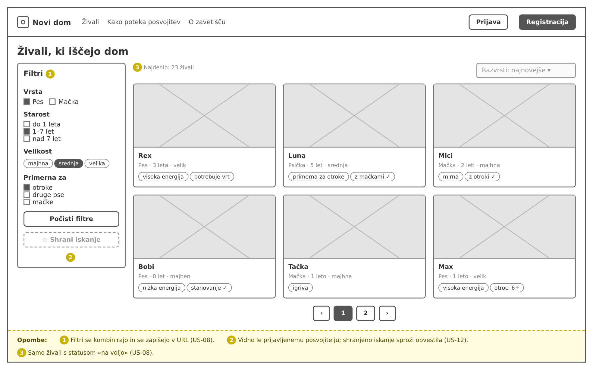
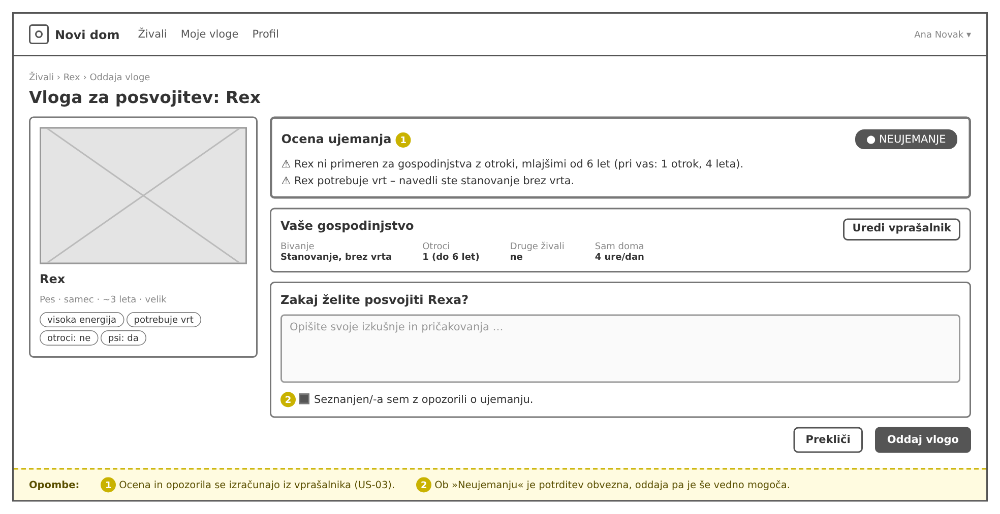
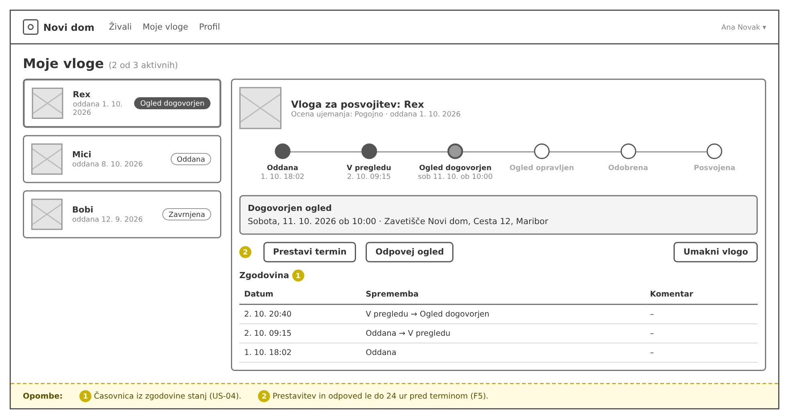
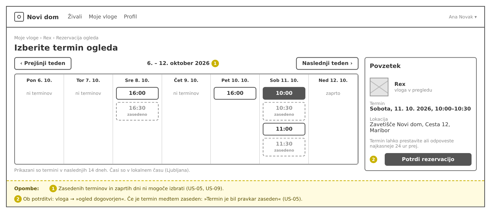
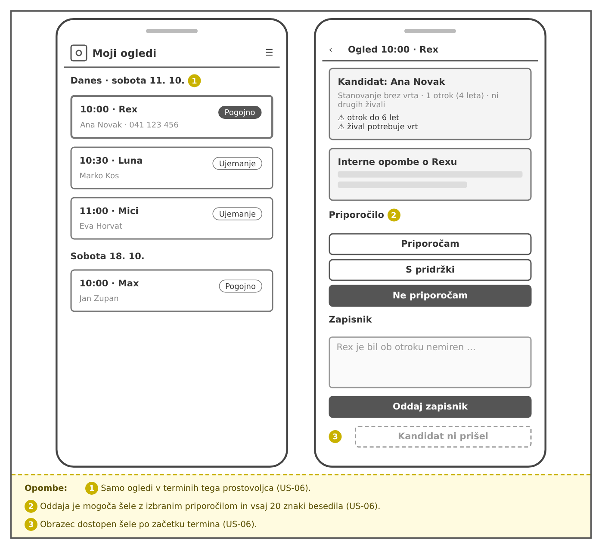
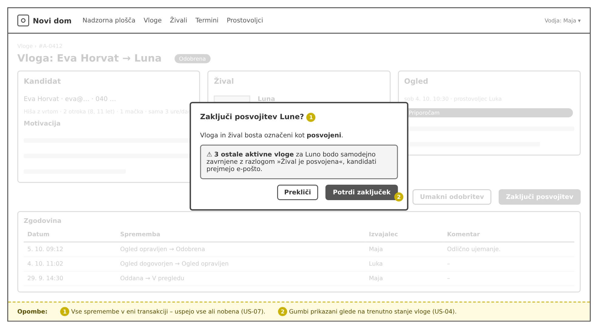
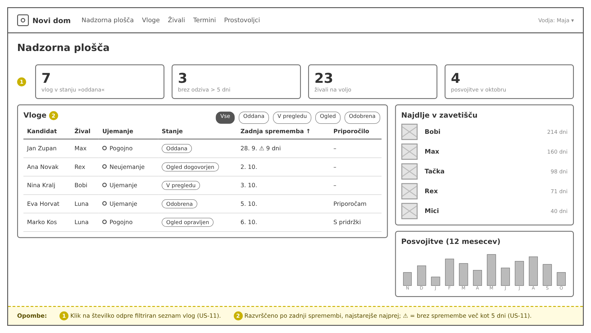

# 06 – Wireframes

Wireframe-i prikazujejo osnovno postavitev ključnih zaslonov aplikacije **Novi dom**. So nizke ločljivosti (sivi okvirji, brez končnih barv in fotografij) in služijo za dogovor o vsebini in razporeditvi elementov, ne o vizualnem slogu.

Rumene številke na slikah označujejo elemente, ki so pojasnjeni v vrstici *Opombe* na dnu posamezne slike. Ob vsakem wireframe-u so navedene uporabniške zgodbe iz `05-uporabniske-zgodbe.md`, ki jih zaslon pokriva.

Slike so v mapi `wireframes/`.

| # | Zaslon | Vloga | Uporabniške zgodbe |
|---|---|---|---|
| 1 | Javni katalog živali | Obiskovalec, posvojitelj | US-08, US-12 |
| 2 | Oddaja vloge z oceno ujemanja | Posvojitelj | US-02, US-03 |
| 3 | Moje vloge s časovnico | Posvojitelj | US-04, US-05 |
| 4 | Rezervacija termina ogleda | Posvojitelj | US-05, US-09 |
| 5 | Moji ogledi in zapisnik (mobilno) | Prostovoljec | US-06 |
| 6 | Podrobnost vloge in zaključek posvojitve | Vodja zavetišča | US-04, US-07 |
| 7 | Nadzorna plošča | Vodja zavetišča | US-11 |

---

## 1. Javni katalog živali

Vstopna stran za obiskovalce. Na levi so filtri (vrsta, starost, velikost, primernost za otroke, pse in mačke), na desni mreža kartic živali s fotografijo, imenom, osnovnimi podatki in značkami lastnosti. Prikazane so samo živali s statusom *na voljo*. Prijavljeni posvojitelj ima dodatno gumb *Shrani iskanje*, na podlagi katerega prejema obvestila o novih primernih živalih.

**Pokriva:** US-08, US-12

---

## 2. Oddaja vloge z oceno ujemanja

Zaslon, ki ga posvojitelj vidi po kliku *Oddaj vlogo* na profilu živali. Levo je povzetek živali, desno na vrhu **ocena ujemanja** z oznako (*Ujemanje / Pogojno / Neujemanje*) in seznamom konkretnih opozoril. Sledita povzetek vprašalnika o gospodinjstvu (z možnostjo urejanja) in polje za motivacijo. Pri oceni *Neujemanje* mora posvojitelj označiti, da je seznanjen z opozorili, oddaja pa ostane mogoča.

**Pokriva:** US-02, US-03

---

## 3. Moje vloge s časovnico

Pregled vseh vlog posvojitelja z oznako stanja in števcem aktivnih vlog (največ 3). Ob izbiri vloge se desno prikaže **časovnica stanj** od *Oddana* do *Posvojena*, trenutni korak je poudarjen. Pod njo so podatki o dogovorjenem ogledu, gumbi za prestavitev ali odpoved termina in umik vloge ter zgodovina sprememb stanja, ki je samo za branje.

**Pokriva:** US-04, US-05

---

## 4. Rezervacija termina ogleda

Tedenski koledar s prostimi termini ogleda. Prosti termini so klikljivi gumbi, zasedeni so črtkani in jih ni mogoče izbrati, zaprti dnevi so označeni. Desno je povzetek izbranega termina z lokacijo in gumbom za potrditev. Ob potrditvi vloga preide v *ogled dogovorjen*. Če je termin medtem zasedel drug posvojitelj, se prikaže sporočilo »Termin je bil pravkar zaseden« in osvežen koledar. Na zaprte dni (tu nedelja) termini niso ustvarjeni.

**Pokriva:** US-05, US-09

---

## 5. Moji ogledi in zapisnik (mobilni pogled)

Prostovoljec aplikacijo uporablja na telefonu v zavetišču. **Levo:** seznam njegovih ogledov po dnevih z uro, živaljo, kandidatom in oceno ujemanja. **Desno:** podrobnost ogleda s povzetkom gospodinjstva kandidata, opozorili, internimi opombami o živali, izbiro priporočila (*Priporočam / S pridržki / Ne priporočam*) in poljem za zapisnik. Zapisnik je dostopen le prostovoljcu, ki mu je termin dodeljen, in šele po začetku termina.

**Pokriva:** US-06

---

## 6. Podrobnost vloge in zaključek posvojitve

Vodja na enem zaslonu vidi vse, kar potrebuje za odločitev: podatke kandidata, žival z oceno ujemanja in zapisnik ogleda s priporočilom prostovoljca. Gumbi za prehode so prikazani glede na trenutno stanje vloge (tu *Odobrena*: *Umakni odobritev* in *Zaključi posvojitev*). Na sliki je odprto **potrditveno okno za zaključek posvojitve**, ki pove, koliko ostalih aktivnih vlog za isto žival bo samodejno zavrnjenih.

**Pokriva:** US-04, US-07

---

## 7. Nadzorna plošča vodje

Začetna stran vodje. Na vrhu so ključne številke (vloge v stanju *oddana*, vloge brez spremembe več kot 5 dni, živali na voljo, posvojitve v tekočem mesecu), ki ob kliku odprejo filtriran seznam. Spodaj je tabela vlog s filtrom po stanju, razvrščena po datumu zadnje spremembe (najstarejše najprej); vloge brez spremembe več kot 5 dni so označene s številom dni. Desno sta seznam živali, ki so najdlje v zavetišču, in graf posvojitev za zadnjih 12 mesecev.

**Pokriva:** US-11
